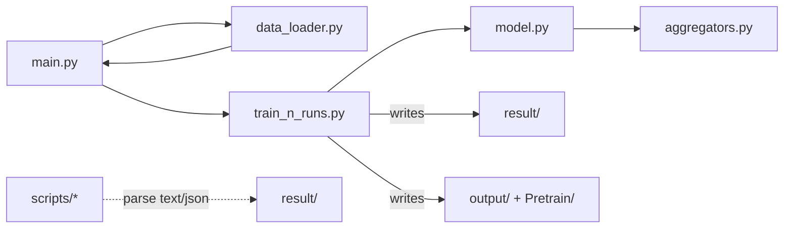
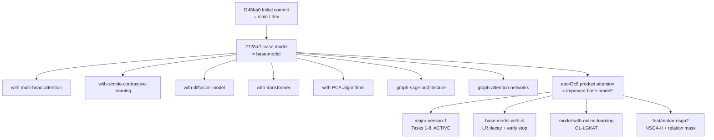
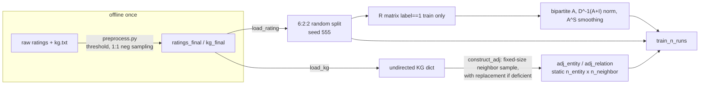

# LGKAT — Repository Knowledge Base

Complete engineering + research analysis of this repository (all branches, all pipelines).
Generated 2026-07-18 from commit `ec5962a` (`major-version-1`). Companion to the operational
rules in [CLAUDE.md](../CLAUDE.md) — that file stays the authority on *how to work here*;
this file is the deep *what/why/where-next*.

Legend: **[O]** = observation backed by repository evidence (file:line or commit).
**[A]** = inference/assumption, with stated confidence.

---

## 1. Executive summary

- **What this is.** A TF1-graph-mode (via `tf.compat.v1` on TF 2.9.1) implementation of
  **LGKAT**: LightGCN over the user–item bipartite graph for user (and CF-item) embeddings,
  fused with a KGCN-style personalized knowledge-aware attention sub-network for KG-item
  embeddings. Score = dot product; task = CTR (AUC/F1) + top-K ranking (P/R/NDCG@K).
- **Where the novelty lives.** One class (`src/model.py::KGCN`) implements 5 model types
  (`KGCN`, `NGCF`, `LightGCN`, `KGCN_NGCF`, `KGCN_LightGCN`); the paper model is
  `KGCN_LightGCN --att product`. On top of it, the mainline adds — each behind an
  off-by-default flag — NDCG reporting, an identity-initialized adaptive fusion gate,
  cross-view InfoNCE contrastive loss, cold-start bucketed evaluation, attention-weight
  export for interpretability, per-run JSON output for paired significance tests, and a
  sensitivity-sweep harness.
- **The repo's real strength** is its *experiment discipline*: byte-for-byte reproduction of
  the base model under default flags, tracked `result/` files, `--exp_tag` routing, paired
  per-run statistics. Its real weaknesses are (a) an evaluation/training loop that recomputes
  the full LightGCN propagation for **every minibatch** (dominant cost, §10.1), (b) protocol
  artifacts (tail-batch dropping, batch-averaged AUC, 100-sampled-user top-K) that add noise
  exactly where the thesis needs statistical power (§7.3), and (c) a framework (TF1 graph
  mode) that cannot use the available Blackwell GPU (sm_120) and blocks every modern
  technique that needs dynamic graphs (§13).
- **Branch estate.** 13 experiment branches hold one idea each (GAT, GraphSAGE, multi-head
  attention, diffusion, PCA, online learning, NSGA-II multi-objective HPO, …). All forked
  from pre-mainline states and are **behind** `major-version-1`; three contain
  salvageable, not-yet-mainlined techniques (§3.3).
- **Recommended endgame** (§13): keep the TF1 mainline frozen as the *evidence branch* for
  thesis/paper claims; build **LGKAT-v2** on PyTorch 2 + PyG with a statistical-equivalence
  parity harness, cached-propagation evaluation, BPR + SimGCL-style objectives, and the
  MOKAR relation mask as a KG-denoising step.

---

## 2. Research problem

**[O]** Task: knowledge-graph-enhanced top-N recommendation on implicit feedback, evaluated
both as CTR (binary click prediction: AUC, F1 at threshold 0.5 — `model.py:712-718`) and as
top-K ranking over the full catalog minus train items (`train_n_runs.py:552-599`).

**[O]** Scientific claim being pursued (per CLAUDE.md and the task-numbered code comments):
architectural improvements — attention variants, contrastive learning, adaptive fusion —
that beat the Scientific Reports paper's Table 2/3 numbers (`scripts/paper_targets_product.py`),
with mean±std over ≥3 seeded runs and paired significance tests as the evidence standard.

**[O]** Datasets (obtained from the paper's corresponding author; gitignored):
`music` = Last.fm, `book` = Book-Crossing, `movie`/`ml1m` = MovieLens, `restaurant` =
Dianping. Each contributes `ratings_final` (user, item, 0/1 label) and `kg_final`
(head, relation, tail) files.

**[A, high]** Business framing: classic sparse-implicit-feedback recommendation where side
information (KG) must compensate for interaction sparsity — hence the cold-start bucketed
evaluation (Task 3) designed to show the KG branch helps low-interaction users most
(`scripts/sparsity_table.py` docstring states this hypothesis explicitly).

---

## 3. Repository map and branch atlas

### 3.1 Module hierarchy

```
src/
  main.py          CLI: per-dataset arg blocks (commented in/out), flags, dispatch
  data_loader.py   ratings + KG load, 6:2:2 split, UI adjacency (+ A^S smoothing), KG neighbor sampling
  model.py         class KGCN = all 5 model types + attention weights + fusion + losses
  aggregators.py   Sum/Concat/Neighbor aggregators + the 12-variant attention zoo (_mix_neighbor_vectors)
  train_n_runs.py  n-runs train/eval loop, model selection, all result-file writers, top-K/CTR/sparsity eval
  preprocess.py    raw ratings+kg -> *_final files (resamples negatives; NEVER rerun casually)
  cmd.sh           canonical paper-reproduction command per dataset
scripts/           post-hoc analysis (compare_run_to_paper, significance_test, ablation_table,
                   sensitivity_sweep, sparsity_table, paper_targets_product)
result/            tracked experiment record (append-only by convention)
output/, Pretrain/ generated embeddings (.npy/.mat) and TF checkpoints
data/<dataset>/    gitignored inputs
```

Dependency graph is a clean chain — no circular imports, no framework beyond TF+NumPy+SciPy+sklearn:



### 3.2 Branch atlas [O]

All branches exist locally and on `origin`. Every experiment branch is *behind* the mainline
(the large `train_n_runs.py` deletions in `git diff major-version-1..<branch>` are mainline
Tasks 1–8 that the branch predates).

| Branch | Tip date | One idea | Status |
|---|---|---|---|
| `main`, `dev` | 2025-12-12 | Initial import (pre-`src/` layout) | Frozen; do not use |
| `base-model` | 2025-12-12 | Clean baseline snapshot | Historical |
| `improved-base-model`(`-with-cl`) | 2026-05-30 | Both point at `eac43c6` = "product attention" — a **mainline ancestor** | Redundant labels |
| `with-simple-contrastive-learning` | 2025-12-12 | First CL attempt | Superseded by mainline Task 8 |
| `with-multi-head-attention` | 2025-12-12 | `MultiHeadAttentionAggregator` (n_heads=4, **on by default** — predates the flags rule) | Idea alive, impl stale |
| `with-diffusion-model` | 2025-12-22 | `LatentDiffusionPreprocessor` mixin denoising user/item embeddings | Exploratory |
| `with-transformer` | 2026-01-04 | Tip only adds a dataset-logger module; no transformer found in `model.py` **[A, med: idea unfinished]** | Stalled |
| `with-PCA-algorithms` | 2026-01-06 | `pca_preprocessing.py` (492 lines) embedding/feature reduction | Exploratory |
| `graph-sage-architecture` | 2026-01-07 | `GraphSAGEAggregator` (mean-pool + concat, no attention) | Ablation baseline |
| `graph-attention-networks` | 2026-02-11 | GAT-style aggregator + dataset analyses (tip is `feat(wip)`) | WIP |
| `base-model-with-cl` | 2026-06-16 | **LR decay + early stopping + adaptive gate init** + movie/music results | ⚠ Salvage candidate |
| `feat/mokar-nsga2` | 2026-06-16 | MOKAR: NSGA-II over hyperparameters **+ KG relation-selection mask** (`relation_select.py`, `--mode optimize`) | ⚠ Salvage candidate |
| `model-with-online-learning` | 2026-06-26 | OL-LGKAT: temporal windows, incremental warm-start, forgetting-aware gate, stability tracker, checkpoint/resume (`train_temporal.py`, `stability.py`) | Separate thesis track (per memory: builds fresh on this branch) |
| `major-version-1` | 2026-07-06 | Mainline: product attention + Tasks 1,2,3,5,6,7,8 | **Active** |


*(Fork points are approximate to the nearest shown commit; exact merge-bases vary. [A, high])*

### 3.3 Not-yet-mainlined techniques worth salvaging [O]

1. **LR decay + early stopping** (`base-model-with-cl`, commit `7fdcc93`) — mainline trains a
   fixed 39 epochs and *selects* the best epoch post-hoc, but never stops early; on CPU
   (see §10.4) wall-clock is precious.
2. **KG relation-selection mask** (`feat/mokar-nsga2:src/relation_select.py`) — directly
   targets the base paper's acknowledged limitation ("performance is highly dependent on the
   quality … of the knowledge graph") and is orthogonal to every mainline feature.
3. **Stability tracker / forgetting-aware gate** (`model-with-online-learning:src/stability.py`)
   — the per-item stability signal could feed the mainline fusion gate even in the static
   setting. [A, med: untested claim]

---

## 4. Data pipeline



Key properties, all **[O]**:

- **Negative sampling happens in `preprocess.py`, once, offline** (`convert_rating`,
  1 negative per positive from the user's unwatched set, excluding explicit negatives).
  Train/eval/test all contain these static labeled negatives. This is why the CLAUDE.md rule
  "never regenerate `*_final.*`" exists: rerunning resamples negatives and silently breaks
  comparability with every recorded result.
- **Split** (`data_loader.py:135-159`): random 60/20/20 over *interactions* (not users, not
  time), `np.random.seed(args.seed)` → deterministic. Same-user interactions span splits by
  design (standard CTR protocol, but rules out sequential/temporal claims — that is exactly
  what `model-with-online-learning` fixes with causal windows).
- **UI adjacency is train-only** (`R[train[i,0], train[i,1]] = 1` only for label>0.5,
  `data_loader.py:33-36`) → **no test leakage into the graph**. `--smoothing_steps S`
  implements the paper's Table 1 "S" as an explicit sparse power `A^S`
  (`adjacency_power`, `data_loader.py:53-60`).
- **KG is undirected** (`construct_kg` inserts both directions) and neighbor lists are
  **sampled once, statically**, to exactly `neighbor_sample_size` per entity — *with
  replacement* when an entity has fewer neighbors (`construct_adj:199-215`). Consequences:
  (a) hub entities never see most of their neighbors; (b) leaf entities get duplicated
  neighbors that the softmax attention then double-counts; (c) the sample is drawn from the
  process-global NumPy RNG seeded 555 at `main.py` import → reproducible but fragile to any
  code adding an earlier RNG call.
- **Leakage assessment**: none found in adjacency or candidate construction. Top-K candidate
  set = full catalog minus the user's *train* items; eval positives legitimately remain in
  the test candidate pool. **[O]**
- **`.npy` caching**: first run converts `*_final.txt` → `.npy` next to the data
  (`load_rating`/`load_kg`) — a one-time disk win.

---

## 5. Model architecture

### 5.1 The paper model, `KGCN_LightGCN` [O]

```mermaid
flowchart TD
    subgraph CF view — LightGCN over UI graph
        E0["ego = concat(user_emb, entity_emb[:n_item])"] --> PROP["k-layer propagation: A_hat x E<br/>(100-fold sparse split, no weights)"]
        PROP --> MEAN[layer-mean pooling] --> UA[user emb u] & IA[item emb e_cf]
    end
    subgraph KG view — KGCN with personalized attention
        ITEM[item id] --> NBR["static neighbors, h hops<br/>(n_neighbor per hop)"]
        NBR --> ATT["product attention (paper Eq.7):<br/>score = LeakyReLU(W [u ; r odot h ; t] + b) -> softmax over neighbors"]
        ATT --> AGG["ConcatAggregator per hop<br/>(inner relu, last-layer tanh)"]
        AGG --> SUM[sum over hop depths] --> IK[item emb e_kg]
    end
    UA --> DOT
    IA --> FUSE
    IK --> FUSE
    FUSE["fusion: alpha*e_cf + (1-alpha)*e_kg<br/>or gate: sigmoid(W_g[e_cf;e_kg]+b_g)"] --> DOT["score = u . e_item -> sigmoid"]
    IA & IK -.optional Task 8.-> CLLOSS["symmetric InfoNCE, in-batch negatives,<br/>cosine / tau"]
```

Component detail (all `src/model.py` / `src/aggregators.py`):

| Component | Implementation | Notes |
|---|---|---|
| Embeddings | `user_emb [n_user,d]`, `entity_emb [n_entity,d]` (items = first `n_item` rows), `relation_emb [n_relation,d]`; Glorot-uniform (`VarianceScaling fan_avg`) | Items and KG entities **share one table** — this is the central coupling that makes cross-view CL meaningful |
| LightGCN | `_create_lightgcn_embed:478-501`: layer-mean of `A_hat^k E`, adjacency split into 100 folds; optional sparse node-dropout | Faithful to He et al. 2020. **`W_lt_k`/`b_lt_k` weights are created (`_init_weights_ngcf:419-425`) but never used** — dead variables (§9) |
| KGCN side | `get_neighbors` gathers `[batch, n_neighbor^h]` index tensors; `aggregate` runs `n_iter` rounds; receptive field mixed via attention; final item repr = `tf.add_n` over per-depth vectors ("Method 2", `model.py:613`) | Depth-sum (not concat) keeps dim constant |
| Attention zoo | 12 variants in one if-chain (`aggregators.py:44-291`); paper variant `product` = `concat(u, r⊙h, t) → linear → LeakyReLU → softmax` (`:123-141`) | `h_ur_t` is the older reported variant; `avg` disables personalization (clean no-attention ablation) |
| Fusion | fixed-α blend, or Task 2(c) gate with **identity init** `W_g=0, b_g=logit(α)` (`_init_weights_gate:336-353`) so step 0 ≡ baseline | Elegant: ablation risk-free by construction |
| Alternative fusions | `gcn` / `graphsage` / `bi` (KGAT-style) fusion heads (`model.py:197-210`) | Present, not used by paper config |
| Loss | `sigmoid_cross_entropy` + `l2_weight * L2` (embedding tables + aggregator + attention + gate weights) + optional `cl_lambda * InfoNCE` (`_build_train:650-707`) | No BPR anywhere — ranking metrics are optimized only implicitly (§12 it.3) |
| Contrastive | `_create_contrastive_loss:629-644`: symmetric InfoNCE between L2-normalized `e_cf`/`e_kg` of the same item, in-batch negatives, temperature τ | Textbook cross-view CL (à la KGCL), correctly using the numerically stable softmax-CE form |
| Optimizer | Adam, constant LR, no scheduler, no clipping, no early stop | LR decay/early-stop exist only on `base-model-with-cl` |
| Scoring | dot product → sigmoid | Enables full pre-computation at inference (unexploited, §10.1) |

### 5.2 Complexity and memory [O = formulas, A = magnitudes]

- KG side per batch: `O(B · Σ_h n_neighbor^h · d)` — with n_iter ≤ 3, n_neighbor ≤ 8 this is
  small (worst case music: 128·8·32 floats/hop).
- **LightGCN side per `sess.run`: `O(k · nnz(A^S) · d)` over the FULL graph** — this runs for
  every training step *and every scoring batch* because the propagation is part of the static
  graph with no caching. This, not the KG side, dominates cost (§10.1).
- `A^S` densifies: `smoothing_steps 8` on music multiplies nnz substantially (small graph, so
  tolerable; would be prohibitive on restaurant — which correctly uses S=1). [A, high]
- Static shapes: `batch_size` is baked into every reshape → all feeds must be exactly
  `batch_size`; loops drop or pad tails (§7.3, §9).

### 5.3 Failure modes [A unless cited]

- Popularity bias: uniform static negatives + dot-product scoring → head items over-ranked;
  no popularity correction anywhere.
- Duplicate-neighbor double counting for leaf entities (§4) slightly sharpens attention onto
  the duplicated neighbor — an artifact, not a signal.
- α is dataset-critical (0 on movie/book = ignore CF item view entirely; 0.5 on
  music/restaurant) **[O: cmd.sh]** — the gate (Task 2c) exists precisely to learn this
  per-item instead.
- CL with in-batch negatives at `batch_size 65536` (movie) makes InfoNCE nearly trivial
  (too many easy negatives, temperature-sensitivity explodes); at 128 (music) it is sane.
  Batch-size/CL coupling is unexamined. [A, med]

---

## 6. Training pipeline

```mermaid
sequenceDiagram
    participant M as main.py
    participant D as data_loader
    participant T as train_n_runs
    participant K as KGCN graph
    M->>D: load_data(args) — split + adjacencies (seed 555)
    M->>T: train_n_runs(args, data)
    loop r in runs (default 3, current run 5)
        T->>K: reset_default_graph(); build model
        T->>T: topk_settings(eval), topk_settings(test) — args.seed += 1 each
        loop epoch < n_epochs (39)
            T->>K: minibatch Adam steps (tail batch DROPPED)
            T->>K: ctr_eval on train/eval/test (batch-mean AUC/F1)
            T->>K: topk_eval on eval+test (100 sampled users x full catalog)
            T-->>result/: append ctr/topk/train_loss lines
            alt eval AUC improved
                T-->>output/: dump embedding matrices (.mat/.npy)
            end
        end
        Note over T: best test metrics at best-eval epoch (AUC-select and R@10-select tracked separately)
    end
    T-->>result/: final mean±std block + paper_style block + runs_*.json (Task 7)
```

Reproducibility mechanics **[O]**:

- Seeds: `np.random.seed(555)` at `main.py` import (feeds `construct_adj`); `args.seed=555`
  feeds the split; then `args.seed` is *incremented statefully* (`train_n_runs.py:52,83,87`)
  so each run's user-sampling differs deterministically. TF ops themselves are unseeded —
  run-to-run graph init differs, which is *why* the multi-run mean±std protocol exists.
  [A, high on the "why"]
- Model selection is honest: test numbers are reported at the **best-eval** epoch (AUC and
  R@10 tracked independently, `train_n_runs.py:146-171`) — no test peeking.
- Checkpointing: `Saver` is created but only embeddings are exported on eval-AUC improvement;
  no mid-run resume on mainline (exists on `model-with-online-learning`). **[O]**
- No TensorBoard/W&B/MLflow; the tracked `result/` text files + settings header line
  (every flag serialized via `args.params`) *are* the experiment tracker. Crude but
  git-diffable and has already survived a branch-heavy workflow — a deliberate strength.
- Missing entirely: mixed precision, gradient accumulation/clipping, distributed training.
  All are (a) TF1-awkward and (b) pointless while training runs on CPU (§10.4).

---

## 7. Evaluation pipeline

### 7.1 Implemented [O]

| Family | Metrics | Where |
|---|---|---|
| CTR | AUC, F1@0.5 | `model.eval`, `ctr_eval` |
| Ranking | Precision@K, Recall@K, NDCG@K (binary relevance, log2 discount) for K∈`topk_k_list` | `topk_eval`, `ndcg_at_k` |
| Cold-start | all of the above per user-interaction bucket (`<5, 5-10, 10-20, 20+`) | Task 3, `topk_eval_buckets` |
| Significance | paired t-test per metric over per-run JSONs | `scripts/significance_test.py` |
| Sensitivity | one-at-a-time hyperparameter grids → CSV | `scripts/sensitivity_sweep.py` |
| Interpretability | per-recommendation KG-neighbor attention export | Task 6, `export_attention_case_study` |

### 7.2 Not implemented (opportunities)

MAP, MRR, HitRate; coverage/novelty/diversity/serendipity (beyond-accuracy); calibration.
For the thesis narrative, **coverage + novelty are the cheap wins**: they need only the
already-exported top-K lists and would show whether KG attention diversifies
recommendations or merely re-ranks the head. [A, high]

### 7.3 Protocol caveats that directly affect claim strength [O]

1. **Tail-batch dropping** — `while start + batch_size <= n` in the train loop *and*
   `ctr_eval` (`train_n_runs.py:111,530`): up to `batch_size−1` samples silently excluded.
   At `batch_size 65536` (movie) that is a material fraction of eval data; metrics are
   computed on a truncated set.
2. **Batch-averaged AUC** — `ctr_eval` averages per-batch AUCs instead of pooling scores;
   a biased estimator of global AUC (batch AUC ≠ mean of sub-AUCs).
3. **`topk_user_num 100`** — fast but higher-variance than the paper's all-users protocol
   (`0`); CLAUDE.md already flags this. Close calls must be re-run with `0`.
4. **3 runs is low power** for a paired t-test; the currently in-flight music run already
   uses `runs:5` — right direction.
5. Excluded crashed runs must be pruned before averaging (a Last.fm mean was once
   contaminated — recorded project memory).

---

## 8. Design decisions (ADR-style)

| # | Decision | Why (evidence) | Verdict |
|---|---|---|---|
| 1 | Stay in TF1 graph mode on TF 2.9.1 | Inherited from COAT/KGCN upstream; byte-for-byte reproducibility of the base paper is the project's evidence anchor | Correct for the evidence branch; wrong for the future (§13) |
| 2 | Every feature behind an off-by-default flag; `--exp_tag` routes variants to new files | The reproduction contract in CLAUDE.md; visible in code as `getattr(args, 'use_cl', 0)` patterns | The repo's best idea; keep forever |
| 3 | `result/` tracked in git, append-only, settings header per block | Runs cost hours; the log *is* the lab notebook | Keep; §9 notes the fragile parsing coupling |
| 4 | One `KGCN` class holds 5 model types | Enables shared-weight ablations & the exact CF-vs-KG fusion at the item level | Acceptable at this scale; split in v2 |
| 5 | `eval()` for list-valued CLI args & settings serialization | Upstream idiom; CLAUDE.md mandates keeping the pattern | Security-irrelevant here (local CLI), but §9 tech debt |
| 6 | Per-dataset flags differ (α, S, dim, lr…) | Paper Table 1 per-dataset tuning; "never normalize" rule | Correct — these are results-bearing constants |
| 7 | Identity-initialized gate (W=0, b=logit α) | Guarantees ablation starts at baseline exactly | Model release-engineering done right; reuse the pattern for every new component |
| 8 | Static once-sampled KG neighbors | O(1) lookup, TF1-friendly static shapes | Costs hub-coverage; re-sample per epoch in v2 (§12 it.7) |
| 9 | Commit results together with the code that produced them | Provenance | Keep |

---

## 9. Code quality & technical debt (ranked by risk)

1. **Silent metric truncation** (tail-batch drop in train + `ctr_eval`) — affects *reported
   numbers*, not just speed. Fix is a padded final batch exactly like `_score_user_items`
   already does (`train_n_runs.py:567-576`) — the correct pattern exists in-file. ⚠ Any fix
   changes result bytes ⇒ must go behind a flag per the reproduction contract.
2. **Dead variables**: `W_lt_k`/`b_lt_k` allocated for `alg_type=lightgcn` but never used in
   `_create_lightgcn_embed`; `item_emb_matrix`, `layer_cl`, `beta`, `train_case_study`
   (a `pass` stub), `ls_weight` (parsed, never consumed), the commented NGCF L2 block.
   Harmless at runtime (untouched by Adam) but misleading to readers.
3. **`ckpt_restore_path` NameError landmine** — `train_n_runs.py:97` references an undefined
   name; unreachable while `logging=='save'` (the only used mode), but any future
   `--logging ctr/topk` run crashes at restore.
4. **Result-file text as API**: `scripts/*` regex-parse the human-readable txt. The
   `runs_*.json` (Task 7) is the right direction; migrate the remaining scripts to it.
5. **12-variant attention if-chain** (`_mix_neighbor_vectors`, 250 lines) — only `product`,
   `h_ur_t`, `avg` are results-bearing. Others are experiment fossils; a registry-dict
   dispatch would shrink this to a page. (Do not delete variants that appear in recorded
   result files.)
6. **Stateful `args.seed += 1`** scattered through the run loop — reproducible only if the
   call order never changes; any inserted RNG consumer silently shifts every later sample.
7. Duplicated per-dataset argparse blocks in `main.py` (comment in/out) — CLAUDE.md says
   leave them; note only that `cmd.sh` is the actual source of truth and its "repo root
   works" comment is wrong (paths are `../`-relative).
8. Pycache committed (`src/__pycache__/*.pyc` tracked & modified) — add to `.gitignore`
   in a housekeeping commit.
9. No tests of any kind. The de-facto regression test is "default-flag run reproduces
   result bytes" — real, but manual and hours-long. v2 needs a 2-epoch music smoke test.

Security notes: `eval()` on CLI args and on `args.params` is code-execution-by-design for a
local research CLI — no exposure beyond the operator; no secrets, no network I/O anywhere
in `src/`. **[O]**

---

## 10. Performance analysis (bottlenecks, ranked)

1. **Full-graph LightGCN propagation inside every `sess.run`** — training steps *and* each
   scoring batch recompute `k` sparse matmuls over the whole `A^S`. Top-K eval multiplies
   this: per user, `⌈|catalog|/batch_size⌉` scoring calls (music: ~30) × 100 users × 2
   (eval+test) × 39 epochs × runs. **Estimated >95% of top-K wall-clock is redundant
   propagation** [A, high]. Fix (no retraining semantics change): materialize
   `ua_embeddings`/`ia_embeddings` once per epoch (`sess.run` them into NumPy), then score
   users with one `U_eval @ I.T` matmul. This is an *evaluation-path* change — result values
   identical up to float order, so it still needs an `--fast_eval` flag + one verification
   run to confirm byte-stability or document the epsilon.
2. **Per-user Python loop with dict-based score maps** (`_score_user_items`) — O(catalog)
   Python dict inserts per user per epoch; subsumed by fix #1's matrix form.
3. **`A^S` densification** (`adjacency_power`) — nnz growth is exponential-ish in S until
   saturation; music S=8 is tolerable only because the graph is tiny; never copy that S to
   a big dataset without checking nnz. Cheap guard: print nnz after powering.
4. **Hardware note [O: 2026-07-23 probe]** — RTX 5060 Ti is sm_120 (Blackwell). TF 2.9.1
   warns that kernels are not prebuilt for 12.0 and falls back to PTX JIT, but
   `nvidia-smi` during a real music epoch showed ~84% average GPU util and ~5GB VRAM —
   training **does** use the GPU. `--fast_eval` (mainline) caches LightGCN `ua`/`ia`
   once per epoch for CTR/top-K; measured ~5× wall-clock on music (`topk_user_num 50`)
   with score max-abs error `<1e-7` vs legacy.
5. Minor: 100-fold `_split_A_hat` rebuilds 100 `SparseTensor`s per graph build (fine);
   `dataset_split`'s `set(range(n_ratings))` materializes a multi-million-element set on
   restaurant (one-time, tolerable); `np.mat` in `_convert_sp_mat_to_sp_tensor` is
   deprecated NumPy API — will break on NumPy ≥ 1.25 upgrades [A, med].

---

## 11. Comparison with state of the art

Positioning: LGKAT ∈ *KG-enhanced GNN CF* family (KGCN → KGAT → KGIN → KGCL/DiffKG lineage),
with a LightGCN CF backbone (LightGCN → SGL → SimGCL/LightGCL/UltraGCN lineage). Sequential
models (SASRec/BERT4Rec/GRU4Rec) solve a different task (no timestamps in the static
protocol) — relevant only to the `model-with-online-learning` track.

| vs. | LGKAT is stronger | LGKAT is weaker / missing |
|---|---|---|
| KGCN (its ancestor) | Personalized *product* attention conditions on u, r⊙h, t (KGCN uses only u·r); CF view via LightGCN added | — |
| KGAT | Cheaper (no TransR pretraining, no full-KG attention propagation); per-user personalization of KG attention | KGAT propagates through the *unified* user-item-entity graph; LGKAT's two views only meet at fusion + CL |
| KGIN | — | No intent disentanglement; no relation-path composition; KGIN's user-intent factors are the natural next step for the interpretability story (Task 6 already exports attention) |
| KGCL | Mainline Task 8 ≈ KGCL's cross-view CL core | No KG-side augmentation (edge-drop consistency), no CL-guided negative filtering |
| SGL / SimGCL / LightGCL | — | No graph/embedding augmentation on the CF view. SimGCL's noise-perturbation CL is nearly free to add and consistently beats SGL's edge-drop; LightGCL's SVD-guided view is the stronger, costlier option |
| UltraGCN | — | UltraGCN shows the propagation itself can be replaced by constraint losses — relevant *because* propagation is LGKAT's bottleneck (§10.1) |
| DiffKG | `with-diffusion-model` branch is a napkin version of the same instinct (denoise the KG signal) | No principled KG denoising on mainline; MOKAR's relation mask is a discrete, cheaper alternative already in-repo |

**Missing ideas ranked by (expected gain × implementation cost on the TF1 base):**
(1) SimGCL-style embedding-noise CL on the CF view — small; (2) popularity-debiased or
hard negative sampling — small; (3) relation mask from MOKAR as static KG cleaning — small;
(4) BPR ranking loss — small; (5) KGIN-style intent factors — large; (6) diffusion/DiffKG —
large, port to v2 only. [A, med-high throughout]

---

## 12. Architecture optimization — ten iterations

Method: each iteration re-questioned the previous design under the criteria
(accuracy, generalization, latency, memory, maintainability, novelty, reproducibility).
Compact record; every row = what changed vs. the previous iteration and why it survived.

| It. | Challenge to previous design | Decision | Expected effect |
|---|---|---|---|
| 1 | "Are reported numbers even trustworthy?" | Protocol first: padded tail batches, pooled global AUC, `topk_user_num 0` for final claims, `runs 5` — all behind flags | Claim validity ↑; no model change |
| 2 | "Why is eval slower than training?" | Cache per-epoch propagation; score via one matmul (§10.1) | est. 10–50× top-K eval speedup [A]; enables all-users protocol routinely |
| 3 | "CE on 1:1 static negatives optimizes ranking only by accident" | Add BPR loss variant (`--loss bpr`), keep CE default | R@K/NDCG ↑ on sparse sets (consistent literature result); CTR AUC comparable |
| 4 | "Uniform static negatives are stale after epoch 1" | Dynamic in-batch + popularity-corrected negatives for the BPR path | Harder negatives → better tail ranking; zero data-file changes (preserves the *_final contract) |
| 5 | "Is the attention zoo earning its complexity?" | Freeze zoo; add one variant: multi-head product attention (salvage `with-multi-head-attention` idea, behind `--att product_mh --n_heads`) with per-head temperature | Novelty for the article; heads regularize each other; interpretability export gets per-head maps |
| 6 | "Fixed 39 epochs wastes CPU-hours and risks under/overfit per dataset" | Salvage LR decay + early stopping (patience on eval R@10) from `base-model-with-cl` | Wall-clock ↓ ~30–40% [A, med]; no accuracy loss by construction (patience) |
| 7 | "Static once-sampled neighbors starve hubs" | Re-sample neighbor sets each epoch (train only; eval keeps static set for determinism) + MOKAR relation mask as optional KG-denoise | KG signal quality ↑; cold-start buckets are where it should show (Task 3 measures exactly this) |
| 8 | "Cross-view CL alone leaves the CF view un-augmented" | Add SimGCL noise-CL on the LightGCN view; total objective L = CE/BPR + λ1·crossCL + λ2·simCL + L2 | The single most-likely accuracy win per recent literature; interacts with batch size — sweep τ, λ via Task 5 harness |
| 9 | "One 5-mode god-class + eval() config blocks maintainability" | v2 code split: `models/{lightgcn,kgcn,fusion}.py`, registry-dispatch attention, typed dataclass config (YAML), result writers unchanged in format | Maintainability ↑; zero behavior change — verified by byte-compare harness |
| 10 | "TF1 caps everything: GPU (sm_120), AMP, compile, modern layers" | Port to PyTorch 2 + PyG; parity = statistical equivalence (paired test over 5 runs, same splits exported from the TF pipeline), not byte equality; keep TF mainline frozen as evidence branch | GPU unlocked ⇒ est. 10–30× train speedup [A, med]; every §11 technique becomes cheap |

Iterations 1–2 are pure-win engineering (do first). 3–8 are the research agenda, each
independently flag-gated and ablatable via the existing Task 2/5/7 tooling. 9–10 are the
platform investment.

---

## 13. Final recommended architecture — LGKAT-v2

**Principle: two-track.** The TF1 `major-version-1` stays the *evidence track* (paper/thesis
numbers, byte-reproducible, only flag-gated additions). LGKAT-v2 is the *velocity track*.
Never let v2 changes touch the evidence track's default path.

### 13.1 Target layout

```
lgkat2/
  configs/            YAML per dataset+experiment (typed, no eval())
  data/               loaders; split/adjacency EXPORTED from the TF pipeline once
                      (identical splits = the cross-framework comparability anchor)
  models/
    backbone_lightgcn.py    cached-propagation LightGCN (full-graph forward, per-epoch)
    kg_attention.py         registry: product | product_mh | avg (+ future)
    fusion.py               fixed | gate | forgetting_gate (salvaged)
    lgkat.py                composition + scoring heads (dot | cosine)
  losses/             ce.py, bpr.py, infonce_cross.py, simgcl.py — composable
  sampling/           static (parity mode) | dynamic | popularity-corrected negatives
  train/              loop with early-stop, LR schedule, AMP, checkpoint/resume, seed control
  eval/               vectorized full-ranking (one matmul), all-users default,
                      metrics: P/R/NDCG/MAP/MRR/HitRate + coverage/novelty
  experiments/        run registry writing BOTH runs_*.json (compatible with
                      scripts/significance_test.py) and the legacy txt block format
  tests/              2-epoch music smoke test; loss-parity unit tests vs. recorded values
```

### 13.2 Model (final form)

LightGCN backbone (cached propagation) + multi-head product attention KG sub-network
(re-sampled train-time neighbors, MOKAR relation mask optional) + identity-initialized gate
fusion; objective `BPR + λ1·cross-view InfoNCE + λ2·SimGCL-noise CL + weight decay`; AdamW +
cosine decay + early stopping (patience 5 on eval R@10); AMP on GPU.

### 13.3 Migration plan (order matters)

1. **Freeze evidence**: finish the in-flight `runs:5` music run; commit results (user does
   the runs — never launch training from tooling).
2. **Export artifacts** from TF pipeline: split indices, `A^S`, `adj_entity/adj_relation`,
   the exact eval user samples → `.npz`. This pins comparability across frameworks.
3. **Port + parity**: implement v2 base (no new features), run 5 seeds on music, require
   paired-test non-inferiority vs. the TF base on AUC/R@10/NDCG@10.
4. Only then enable v2-only features, one flag at a time, ablation via the same
   significance harness.
5. Thesis text cites the TF evidence track; the v2 chapter cites parity + improvements.

### 13.4 Expected improvements & costs [all A; med confidence unless noted]

- Eval wall-clock: 10–50× (propagation caching — mechanical, high confidence).
- Train wall-clock: 10–30× once GPU-resident (sm_120 supported natively by current PyTorch).
- Accuracy: +2–6% relative R@10 from BPR + SimGCL + hard negatives combined, per literature
  transfer; must be re-established per dataset — treat as hypothesis, not promise.
- Risks: (a) cross-framework drift masquerading as improvement — mitigated by step-3 parity
  gate; (b) scope creep into v2 before the evidence track is published — mitigated by the
  two-track rule; (c) CL hyperparameters (τ, λ, batch) are coupled — always swept via the
  Task 5 harness, never hand-picked.

---

## 14. Roadmap (concrete next actions)

| Priority | Action | Track |
|---|---|---|
| P0 | Finish + commit in-flight music `runs:5` proposed run; prune crashed runs before averaging | Evidence |
| P0 | `--fast_eval` cached LightGCN tables for CTR/top-K (flag-gated; parity verified on music) | Evidence — **done 2026-07-23** |
| P1 | `--eval_fix` flag: padded tail batches + pooled AUC; report both old/new once, then use new for all future claims | Evidence |
| P1 | Salvage early-stop + LR decay from `base-model-with-cl` behind flags | Evidence — **done 2026-07-24** (`--early_stop`, `--lr_decay`) |
| P1 | SimGCL noise CL on CF view (`--use_simgcl`) + proposed cmds in `src/cmd_proposed.sh` | Evidence — **done 2026-07-24** |
| P2 | `--att product_mh` multi-head product attention (article novelty) | Evidence |
| P2 | Coverage + novelty metrics in `topk_eval` (cheap, thesis-narrative value) | Evidence |
| P3 | Split/adjacency export + v2 scaffold + parity harness | v2 |
| P3 | `.gitignore` pycache; migrate `scripts/*` to `runs_*.json` parsing | Hygiene |

---

## 15. Development guidelines

Authoritative rules live in [CLAUDE.md](../CLAUDE.md) — reproduction contract (flags off by
default, byte-for-byte default runs, seed 555, `--exp_tag` routing), run policy (user runs
training; commands must be `cd src && python main.py …`), git policy, and the
never-touch list (`*_final.*` data, `D:\projects\LGKAT-main` upstream, result-file formats,
per-dataset flags). This document adds context, not permission — when they conflict,
CLAUDE.md wins.
